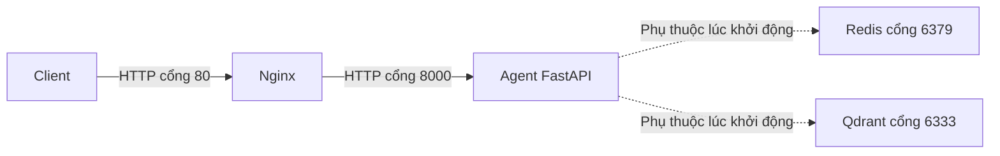

# Day 14 Lab — Mission Answers

## Part 1 — Localhost vs Production

### Exercise 1.1 — Anti-patterns trong bản develop

1. **Ghi thông tin kết nối trực tiếp trong code.** [Dòng 17–18](01-localhost-vs-production/develop/app.py#L17-L18) gán API key và URL database có mật khẩu trong mã nguồn. Nếu dùng thông tin thật, người đọc repo hoặc lịch sử Git có thể lấy được.
2. **Giá trị cấu hình cố định.** [Dòng 21–22](01-localhost-vs-production/develop/app.py#L21-L22) gán trực tiếp `DEBUG` và `MAX_TOKENS`. Muốn đổi các giá trị này giữa local, staging và production phải sửa code.
3. **In câu hỏi, API key và câu trả lời ra log.** [Dòng 33–38](01-localhost-vs-production/develop/app.py#L33-L38) dùng `print()`. Log dễ chứa dữ liệu người dùng và credential, đồng thời khó lọc theo mức độ hoặc loại sự kiện.
4. **Thiếu endpoint kiểm tra liveness.** [Dòng 42–43](01-localhost-vs-production/develop/app.py#L42-L43) ghi chú về `/health` nhưng chưa khai báo route. Khi chạy thử, em nhận được `404 Not Found` từ endpoint này.
5. **Bind vào loopback và cố định cổng.** [Dòng 51–52](01-localhost-vs-production/develop/app.py#L51-L52) chọn `localhost:8000`. Trong container, bind vào loopback khiến kết nối từ bên ngoài container khó tới được app. Cổng cố định cũng có thể lệch với `PORT` do nền tảng cấp.
6. **Luôn bật reloader.** [Dòng 53](01-localhost-vs-production/develop/app.py#L53) đặt `reload=True`. Log lúc chạy xác nhận WatchFiles được bật. Cơ chế này theo dõi file và khởi động lại app khi có thay đổi, hữu ích lúc phát triển nhưng có thể làm gián đoạn request khi deploy.

### Exercise 1.2 — Chạy bản develop

Em chạy `python app.py` trong `01-localhost-vs-production/develop/`. Uvicorn khởi động tại `http://localhost:8000`.

```bash
curl -i -X POST 'http://localhost:8000/ask?question=Hello'
curl -i 'http://localhost:8000/health'
```

Kết quả thực tế của `POST /ask?question=Hello`:

```http
HTTP/1.1 200 OK
content-type: application/json

{"answer":"Tôi là AI agent được deploy lên cloud. Câu hỏi của bạn đã được nhận."}
```

Kết quả thực tế của `GET /health`:

```http
HTTP/1.1 404 Not Found
content-type: application/json

{"detail":"Not Found"}
```

Em dùng query string vì [handler bản develop](01-localhost-vs-production/develop/app.py#L29-L31) nhận `question` qua query. Trong lần chạy này, log server cũng in giá trị API key mẫu và toàn bộ câu hỏi.

### Exercise 1.3 — So sánh với bản production

Trong `01-localhost-vs-production/production/`, em chạy bản production với cấu hình local và dùng mock LLM.

```bash
HOST=127.0.0.1 PORT=8000 DEBUG=false ENVIRONMENT=development python app.py
```

| Lệnh kiểm tra | Kết quả thực tế |
| --- | --- |
| `GET /health` | `200 OK`, body có `"status":"ok"` và `"uptime_seconds":10.4`. |
| `GET /ready` | `200 OK`, body `{"ready":true}`. |
| `POST /ask` với JSON `{"question":"Hello"}` | `200 OK`, body có `question`, câu trả lời từ mock và `"model":"gpt-4o-mini"`. |

| Tiêu chí | Develop | Production | Vì sao quan trọng |
| --- | --- | --- | --- |
| Cấu hình | [Các giá trị host, port và reload cố định](01-localhost-vs-production/develop/app.py#L49-L54). | [`config.py` đọc `HOST`, `PORT` và `DEBUG` từ môi trường](01-localhost-vs-production/production/config.py#L14-L19). | Có thể dùng cùng một mã nguồn ở nhiều môi trường và cấu hình theo cổng nền tảng cấp. |
| Health và readiness | `GET /health` trả 404. | [`/health` kiểm tra liveness và `/ready` đọc trạng thái sẵn sàng](01-localhost-vs-production/production/app.py#L135-L161). Cả hai trả 200 sau khi app khởi động. | Liveness cho biết app còn phản hồi. Readiness giúp quyết định có nên chuyển traffic vào app. |
| Logging | [`print()` in câu hỏi, key và câu trả lời](01-localhost-vs-production/develop/app.py#L32-L38). | [Code ghi sự kiện và độ dài câu hỏi, câu trả lời bằng logger](01-localhost-vs-production/production/app.py#L110-L122). Output em thu được có warning về mock và access log của Uvicorn. | Các trường theo sự kiện hỗ trợ tìm kiếm và theo dõi request mà không cần ghi API key hay toàn văn câu hỏi. |
| Shutdown | App chưa khai báo bước dọn dẹp riêng. | [FastAPI lifespan đặt `is_ready = False` khi shutdown](01-localhost-vs-production/production/app.py#L39-L74). Nhận xét này dựa trên mã nguồn. | Lifecycle hook cho phép dọn tài nguyên khi app tắt. Graceful shutdown giúp các request đang xử lý có thời gian hoàn tất. |

## Part 2 — Docker

### Exercise 2.1 — Dockerfile cơ bản

1. **Base image.** Dockerfile dùng `python:3.11`, image Python đầy đủ có sẵn Python 3.11 để chạy ứng dụng. [Dòng 6–8](02-docker/develop/Dockerfile#L6-L8)
2. **Working directory.** `WORKDIR /app` đặt thư mục làm việc bên trong container. Các đường dẫn đích tương đối trong `COPY` và lệnh `python app.py` được tính từ `/app`. [Dòng 10–20](02-docker/develop/Dockerfile#L10-L20)
3. **Thứ tự copy `requirements.txt`.** Docker copy `requirements.txt` và chạy `pip install` trước khi copy mã nguồn. Khi em chỉ sửa `app.py`, Docker có thể dùng lại layer cài dependencies từ cache, giúp lần build sau nhanh hơn. [Dòng 13–20](02-docker/develop/Dockerfile#L13-L20)
4. **`CMD` và `ENTRYPOINT`.** `CMD` đặt lệnh hoặc đối số mặc định và có thể được thay bằng đối số truyền sau tên image trong `docker run`. `ENTRYPOINT` dạng exec đặt chương trình chính của container. Khi dùng cả hai, `CMD` thường cung cấp đối số mặc định cho `ENTRYPOINT`. Dockerfile này dùng `CMD ["python", "app.py"]` để chạy app theo mặc định. [Dòng 29–30](02-docker/develop/Dockerfile#L29-L30)

### Exercise 2.2 — Build và chạy container develop

Em chạy các lệnh sau từ gốc repo. Em truyền `question` qua query string theo cách [handler develop](02-docker/develop/app.py#L20-L22) nhận dữ liệu.

```bash
docker build -f 02-docker/develop/Dockerfile -t my-agent:develop .
docker run --rm -d --name day14-cp2-develop -p 127.0.0.1:8000:8000 my-agent:develop
curl -i http://127.0.0.1:8000/health
curl -i -X POST 'http://127.0.0.1:8000/ask?question=What%20is%20Docker%3F'
```

Docker build thành công image `my-agent:develop`. Lệnh `docker run` báo `Conflict` vì tên `day14-cp2-develop` đã được dùng. Hai lệnh `curl` vẫn nhận phản hồi từ app đang nghe trên cổng `8000`.

Kết quả thực tế của `GET /health`:

```http
HTTP/1.1 200 OK
content-type: application/json

{"status":"ok","uptime_seconds":49.6,"container":true}
```

Kết quả thực tế của `POST /ask`:

```http
HTTP/1.1 200 OK
content-type: application/json

{"answer":"Container là cách đóng gói app để chạy ở mọi nơi. Build once, run anywhere!"}
```

### Exercise 2.3 — Multi-stage build và dung lượng image

- **Builder.** Stage `builder` dùng `python:3.11-slim`, cài `gcc` và `libpq-dev`, rồi cài Python dependencies vào `/root/.local`. [Dòng 16–29](02-docker/production/Dockerfile#L16-L29)
- **Runtime.** Stage `runtime` bắt đầu từ một image `python:3.11-slim` mới, lấy các Python packages đã cài từ `builder`, thêm code của app và chạy bằng user `appuser`. Base image `slim` và việc giữ công cụ biên dịch ở stage `builder` giúp giảm dung lượng image cuối. [Dòng 36–58](02-docker/production/Dockerfile#L36-L58)

Em build image production và đo hai image bằng `docker images` từ gốc repo.

```bash
docker build -f 02-docker/production/Dockerfile -t my-agent:advanced .
docker images my-agent --format 'table {{.Repository}}\t{{.Tag}}\t{{.Size}}'
```

| Image | Dung lượng Docker hiển thị | Dung lượng quy về MB |
| --- | ---: | ---: |
| `my-agent:develop` | 1.67 GB | 1.670 MB |
| `my-agent:advanced` | 265 MB | 265 MB |

Theo số hiển thị, image production giảm khoảng **84,1%** so với develop, tính bằng `(1.670 − 265) / 1.670 × 100`.

### Exercise 2.4 — Docker Compose và Nginx



Nginx nhận request từ máy host trên cổng `80` rồi chuyển tiếp đến `agent:8000` qua mạng `internal` của Compose. Redis là dịch vụ cache và Qdrant là cơ sở dữ liệu vector. Compose chờ hai dịch vụ này healthy trước khi khởi động agent. Đường nét đứt trong sơ đồ thể hiện phụ thuộc lúc khởi động. Trong lần test này, handler `/ask` gọi mock LLM trực tiếp. [Compose](02-docker/production/docker-compose.yml#L22-L51) · [Nginx](02-docker/production/nginx/nginx.conf#L14-L29) · [Handler `/ask`](02-docker/production/main.py#L57-L64)

Em kiểm tra stack và gọi hai endpoint từ máy host bằng các lệnh sau.

```bash
docker compose -p k5-day14-docker ps
curl -i http://127.0.0.1/health
curl -i -X POST http://127.0.0.1/ask \
  -H 'Content-Type: application/json' \
  -d '{"question":"Explain microservices"}'
```

Kết quả `docker compose ps` cho thấy cả bốn service đều chạy.

| Service | Trạng thái | Cổng trong output |
| --- | --- | --- |
| `agent` | Up, healthy | `8000/tcp` |
| `nginx` | Up | Host `80` → `80/tcp`, host `443` → `443/tcp` |
| `qdrant` | Up, healthy | `6333–6334/tcp` |
| `redis` | Up, healthy | `6379/tcp` |

`GET /health` trả về kết quả sau qua Nginx.

```http
HTTP/1.1 200 OK
Server: nginx
Content-Type: application/json

{"status":"ok","uptime_seconds":429.9,"version":"2.0.0","timestamp":"2026-11-26T09:05:12.670490"}
```

`POST /ask` nhận câu hỏi trong JSON và trả lời qua Nginx.

```http
HTTP/1.1 200 OK
Server: nginx
Content-Type: application/json

{"answer":"Đây là câu trả lời từ AI agent (mock). Trong production, đây sẽ là response từ OpenAI/Anthropic."}
```

## AI log

- **CP1:** Em hỏi Codex về thứ tự làm lab và cách thực hiện Exercise 1.1–1.3. Codex gợi ý dòng code cần đọc, chỉ ra cú pháp query string của bản develop và soạn phần trình bày từ output em cung cấp. Em tự chạy hai app trong terminal, dùng `curl` để kiểm tra mã HTTP và nội dung phản hồi, rồi gửi output thực tế làm bằng chứng.
- **CP2, Exercise 2.1–2.2.** Em hỏi Codex cách đọc Dockerfile, chạy container và hiểu lỗi trùng tên. Codex giải thích các chỉ thị trong Dockerfile và soạn mục trả lời từ log em cung cấp. Em tự chạy `docker build`, `docker run` và hai lệnh `curl` trong terminal, rồi gửi output để ghi lại kết quả thực tế.
- **CP2, Exercise 2.3.** Em chạy build và `docker images` để lấy dung lượng hai image. Codex giải thích hai stage trong Dockerfile production và tính phần trăm giảm từ số đo em gửi.
- **CP2, Exercise 2.4.** Em hỏi Codex cách chạy Compose và kiểm tra API qua Nginx. Em tự chạy stack, xem trạng thái bằng `docker compose ps` và dùng `curl` để kiểm tra hai endpoint. Codex đối chiếu cấu hình để vẽ sơ đồ và ghi kết quả từ output em gửi.
