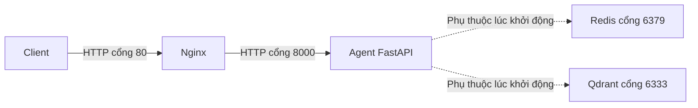

# Day 14 Lab — Mission Answers

## Part 1 — Localhost vs Production

### Exercise 1.1 — Anti-patterns trong bản develop

1. **Ghi thông tin kết nối trực tiếp trong code.** [Dòng 17–18](01-localhost-vs-production/develop/app.py#L17-L18) gán API key và URL database có mật khẩu trong mã nguồn. Nếu dùng thông tin thật, người đọc repo hoặc lịch sử Git có thể lấy được.
2. **Giá trị cấu hình cố định.** [Dòng 21–22](01-localhost-vs-production/develop/app.py#L21-L22) gán trực tiếp `DEBUG` và `MAX_TOKENS`. Muốn đổi các giá trị này giữa local, staging và production phải sửa code.
3. **In câu hỏi, API key và câu trả lời ra log.** [Dòng 33–38](01-localhost-vs-production/develop/app.py#L33-L38) dùng `print()`. Log dễ chứa dữ liệu người dùng và credential, đồng thời khó lọc theo mức độ hoặc loại sự kiện.
4. **Thiếu endpoint kiểm tra liveness.** [Dòng 42–43](01-localhost-vs-production/develop/app.py#L42-L43) ghi chú về `/health` nhưng chưa khai báo route. Khi chạy thử, em nhận được `404 Not Found` từ endpoint này.
5. **Bind vào loopback và cố định cổng.** [Dòng 51–52](01-localhost-vs-production/develop/app.py#L51-L52) chọn `localhost:8000`. Trong container, bind vào loopback khiến kết nối từ bên ngoài container khó tới được app. Cổng cố định cũng có thể lệch với `PORT` do nền tảng cấp.
6. **Luôn bật reloader.** [Dòng 53](01-localhost-vs-production/develop/app.py#L53) đặt `reload=True`. Log lúc chạy xác nhận WatchFiles được bật. Cơ chế này theo dõi file và khởi động lại app khi có thay đổi, hữu ích lúc phát triển nhưng có thể làm gián đoạn request khi deploy.

### Exercise 1.2 — Chạy bản develop

Em chạy `python app.py` trong `01-localhost-vs-production/develop/`. Uvicorn khởi động tại `http://localhost:8000`.

```bash
curl -i -X POST 'http://localhost:8000/ask?question=Hello'
curl -i 'http://localhost:8000/health'
```

Kết quả thực tế của `POST /ask?question=Hello`:

```http
HTTP/1.1 200 OK
content-type: application/json

{"answer":"Tôi là AI agent được deploy lên cloud. Câu hỏi của bạn đã được nhận."}
```

Kết quả thực tế của `GET /health`:

```http
HTTP/1.1 404 Not Found
content-type: application/json

{"detail":"Not Found"}
```

Em dùng query string vì [handler bản develop](01-localhost-vs-production/develop/app.py#L29-L31) nhận `question` qua query. Trong lần chạy này, log server cũng in giá trị API key mẫu và toàn bộ câu hỏi.

### Exercise 1.3 — So sánh với bản production

Trong `01-localhost-vs-production/production/`, em chạy bản production với cấu hình local và dùng mock LLM.

```bash
HOST=127.0.0.1 PORT=8000 DEBUG=false ENVIRONMENT=development python app.py
```

| Lệnh kiểm tra | Kết quả thực tế |
| --- | --- |
| `GET /health` | `200 OK`, body có `"status":"ok"` và `"uptime_seconds":10.4`. |
| `GET /ready` | `200 OK`, body `{"ready":true}`. |
| `POST /ask` với JSON `{"question":"Hello"}` | `200 OK`, body có `question`, câu trả lời từ mock và `"model":"gpt-4o-mini"`. |

| Tiêu chí | Develop | Production | Vì sao quan trọng |
| --- | --- | --- | --- |
| Cấu hình | [Các giá trị host, port và reload cố định](01-localhost-vs-production/develop/app.py#L49-L54). | [`config.py` đọc `HOST`, `PORT` và `DEBUG` từ môi trường](01-localhost-vs-production/production/config.py#L14-L19). | Có thể dùng cùng một mã nguồn ở nhiều môi trường và cấu hình theo cổng nền tảng cấp. |
| Health và readiness | `GET /health` trả 404. | [`/health` kiểm tra liveness và `/ready` đọc trạng thái sẵn sàng](01-localhost-vs-production/production/app.py#L135-L161). Cả hai trả 200 sau khi app khởi động. | Liveness cho biết app còn phản hồi. Readiness giúp quyết định có nên chuyển traffic vào app. |
| Logging | [`print()` in câu hỏi, key và câu trả lời](01-localhost-vs-production/develop/app.py#L32-L38). | [Code ghi sự kiện và độ dài câu hỏi, câu trả lời bằng logger](01-localhost-vs-production/production/app.py#L110-L122). Output em thu được có warning về mock và access log của Uvicorn. | Các trường theo sự kiện hỗ trợ tìm kiếm và theo dõi request mà không cần ghi API key hay toàn văn câu hỏi. |
| Shutdown | App chưa khai báo bước dọn dẹp riêng. | [FastAPI lifespan đặt `is_ready = False` khi shutdown](01-localhost-vs-production/production/app.py#L39-L74). Nhận xét này dựa trên mã nguồn. | Lifecycle hook cho phép dọn tài nguyên khi app tắt. Graceful shutdown giúp các request đang xử lý có thời gian hoàn tất. |

## Part 2 — Docker

### Exercise 2.1 — Dockerfile cơ bản

1. **Base image.** Dockerfile dùng `python:3.11`, image Python đầy đủ có sẵn Python 3.11 để chạy ứng dụng. [Dòng 6–8](02-docker/develop/Dockerfile#L6-L8)
2. **Working directory.** `WORKDIR /app` đặt thư mục làm việc bên trong container. Các đường dẫn đích tương đối trong `COPY` và lệnh `python app.py` được tính từ `/app`. [Dòng 10–20](02-docker/develop/Dockerfile#L10-L20)
3. **Thứ tự copy `requirements.txt`.** Docker copy `requirements.txt` và chạy `pip install` trước khi copy mã nguồn. Khi em chỉ sửa `app.py`, Docker có thể dùng lại layer cài dependencies từ cache, giúp lần build sau nhanh hơn. [Dòng 13–20](02-docker/develop/Dockerfile#L13-L20)
4. **`CMD` và `ENTRYPOINT`.** `CMD` đặt lệnh hoặc đối số mặc định và có thể được thay bằng đối số truyền sau tên image trong `docker run`. `ENTRYPOINT` dạng exec đặt chương trình chính của container. Khi dùng cả hai, `CMD` thường cung cấp đối số mặc định cho `ENTRYPOINT`. Dockerfile này dùng `CMD ["python", "app.py"]` để chạy app theo mặc định. [Dòng 29–30](02-docker/develop/Dockerfile#L29-L30)

### Exercise 2.2 — Build và chạy container develop

Em chạy các lệnh sau từ gốc repo. Em truyền `question` qua query string theo cách [handler develop](02-docker/develop/app.py#L20-L22) nhận dữ liệu.

```bash
docker build -f 02-docker/develop/Dockerfile -t my-agent:develop .
docker run --rm -d --name day14-cp2-develop -p 127.0.0.1:8000:8000 my-agent:develop
curl -i http://127.0.0.1:8000/health
curl -i -X POST 'http://127.0.0.1:8000/ask?question=What%20is%20Docker%3F'
```

Docker build thành công image `my-agent:develop`. Lệnh `docker run` báo `Conflict` vì tên `day14-cp2-develop` đã được dùng. Hai lệnh `curl` vẫn nhận phản hồi từ app đang nghe trên cổng `8000`.

Kết quả thực tế của `GET /health`:

```http
HTTP/1.1 200 OK
content-type: application/json

{"status":"ok","uptime_seconds":49.6,"container":true}
```

Kết quả thực tế của `POST /ask`:

```http
HTTP/1.1 200 OK
content-type: application/json

{"answer":"Container là cách đóng gói app để chạy ở mọi nơi. Build once, run anywhere!"}
```

### Exercise 2.3 — Multi-stage build và dung lượng image

- **Builder.** Stage `builder` dùng `python:3.11-slim`, cài `gcc` và `libpq-dev`, rồi cài Python dependencies vào `/root/.local`. [Dòng 16–29](02-docker/production/Dockerfile#L16-L29)
- **Runtime.** Stage `runtime` bắt đầu từ một image `python:3.11-slim` mới, lấy các Python packages đã cài từ `builder`, thêm code của app và chạy bằng user `appuser`. Base image `slim` và việc giữ công cụ biên dịch ở stage `builder` giúp giảm dung lượng image cuối. [Dòng 36–58](02-docker/production/Dockerfile#L36-L58)

Em build image production và đo hai image bằng `docker images` từ gốc repo.

```bash
docker build -f 02-docker/production/Dockerfile -t my-agent:advanced .
docker images my-agent --format 'table {{.Repository}}\t{{.Tag}}\t{{.Size}}'
```

| Image | Dung lượng Docker hiển thị | Dung lượng quy về MB |
| --- | ---: | ---: |
| `my-agent:develop` | 1.67 GB | 1.670 MB |
| `my-agent:advanced` | 265 MB | 265 MB |

Theo số hiển thị, image production giảm khoảng **84,1%** so với develop, tính bằng `(1.670 − 265) / 1.670 × 100`.

### Exercise 2.4 — Docker Compose và Nginx



Nginx nhận request từ máy host trên cổng `80` rồi chuyển tiếp đến `agent:8000` qua mạng `internal` của Compose. Redis là dịch vụ cache và Qdrant là cơ sở dữ liệu vector. Compose chờ hai dịch vụ này healthy trước khi khởi động agent. Đường nét đứt trong sơ đồ thể hiện phụ thuộc lúc khởi động. Trong lần test này, handler `/ask` gọi mock LLM trực tiếp. [Compose](02-docker/production/docker-compose.yml#L22-L51) · [Nginx](02-docker/production/nginx/nginx.conf#L14-L29) · [Handler `/ask`](02-docker/production/main.py#L57-L64)

Em kiểm tra stack và gọi hai endpoint từ máy host bằng các lệnh sau.

```bash
docker compose -p k5-day14-docker ps
curl -i http://127.0.0.1/health
curl -i -X POST http://127.0.0.1/ask \
  -H 'Content-Type: application/json' \
  -d '{"question":"Explain microservices"}'
```

Kết quả `docker compose ps` cho thấy cả bốn service đều chạy.

| Service | Trạng thái | Cổng trong output |
| --- | --- | --- |
| `agent` | Up, healthy | `8000/tcp` |
| `nginx` | Up | Host `80` → `80/tcp`, host `443` → `443/tcp` |
| `qdrant` | Up, healthy | `6333–6334/tcp` |
| `redis` | Up, healthy | `6379/tcp` |

`GET /health` trả về kết quả sau qua Nginx.

```http
HTTP/1.1 200 OK
Server: nginx
Content-Type: application/json

{"status":"ok","uptime_seconds":429.9,"version":"2.0.0","timestamp":"2026-11-26T09:05:12.670490"}
```

`POST /ask` nhận câu hỏi trong JSON và trả lời qua Nginx.

```http
HTTP/1.1 200 OK
Server: nginx
Content-Type: application/json

{"answer":"Đây là câu trả lời từ AI agent (mock). Trong production, đây sẽ là response từ OpenAI/Anthropic."}
```

## Part 4 — API Security

### Exercise 4.1 — Xác thực bằng API key

Em gửi ba request `POST /ask` đến bản develop, cùng body `{"question":"Hello"}`. Em dùng `curl -i` để ghi lại mã HTTP, header và nội dung phản hồi.

**Thiếu header `X-API-Key`**

```http
HTTP/1.1 401 Unauthorized
date: Thu, 26 Nov 2026 09:55:53 GMT
server: uvicorn
content-length: 67
content-type: application/json

{"detail":"Missing API key. Include header: X-API-Key: <your-key>"}
```

**Gửi sai API key**

```http
HTTP/1.1 403 Forbidden
date: Thu, 26 Nov 2026 09:55:53 GMT
server: uvicorn
content-length: 29
content-type: application/json

{"detail":"Invalid API key."}
```

**Gửi đúng API key**

```http
HTTP/1.1 200 OK
date: Thu, 26 Nov 2026 09:55:53 GMT
server: uvicorn
content-length: 114
content-type: application/json

{"question":"Hello","answer":"Agent đang hoạt động tốt! (mock response) Hỏi thêm câu hỏi đi nhé."}
```

- **API key được kiểm tra ở đâu?** `POST /ask` dùng `Depends(verify_api_key)`. Dependency đọc header `X-API-Key` và so sánh với giá trị app lấy từ biến môi trường `AGENT_API_KEY`. [Dependency](04-api-gateway/develop/app.py#L35-L54) · [Route `/ask`](04-api-gateway/develop/app.py#L67-L79)
- **Khi key sai thì sao?** Kết quả chạy của em cho thấy thiếu key trả `401`, key sai trả `403`, còn key đúng cho phép request đi tiếp và nhận câu trả lời mock với mã `200`. [Các nhánh kiểm tra](04-api-gateway/develop/app.py#L44-L54)
- **Đổi key thế nào?** Cập nhật `AGENT_API_KEY` trong môi trường chạy, khởi động lại app để nạp giá trị mới rồi cập nhật header `X-API-Key` ở client. [Cách app đọc biến môi trường](04-api-gateway/develop/app.py#L35)

### Exercise 4.2 — Xác thực bằng JWT

Em đăng nhập bằng tài khoản demo `student` qua `POST /auth/token`, lưu `access_token` vào biến `TOKEN` rồi gửi `Authorization: Bearer $TOKEN` khi gọi `POST /ask` với câu hỏi `Explain JWT`. Đây là phản hồi em nhận được bằng `curl -i`.

```http
HTTP/1.1 200 OK
date: Thu, 26 Nov 2026 10:04:10 GMT
server: uvicorn
content-length: 184
content-type: application/json
x-content-type-options: nosniff
x-frame-options: DENY
x-xss-protection: 1; mode=block
referrer-policy: strict-origin-when-cross-origin

{"question":"Explain JWT","answer":"Agent đang hoạt động tốt! (mock response) Hỏi thêm câu hỏi đi nhé.","usage":{"requests_remaining":9,"budget_remaining_usd":1.6e-05}}
```

Khi thông tin đăng nhập hợp lệ, server ký JWT bằng `HS256`. Token chứa username (`sub`), role (`role`), thời điểm cấp (`iat`) và thời điểm hết hạn (`exp`) sau 60 phút. Khi em gửi bearer token, `Depends(verify_token)` kiểm tra chữ ký và hạn dùng trước khi handler xử lý câu hỏi. [Endpoint đăng nhập](04-api-gateway/production/app.py#L105-L118) · [Tạo và xác minh JWT](04-api-gateway/production/auth.py#L35-L67)

Phản hồi `200 OK` xác nhận request dùng JWT đã được xử lý. Trường `requests_remaining: 9` cho biết em còn 9 lượt trong cửa sổ rate limit hiện tại. Code mẫu gán `usage.total_cost_usd` vào trường `budget_remaining_usd`, nên giá trị `1.6e-05` là chi phí đã ghi nhận. [Handler `/ask`](04-api-gateway/production/app.py#L125-L162)

### Exercise 4.3 — Rate limiting

Em dùng JWT của tài khoản demo `student` để gửi liên tiếp 20 request `POST /ask` với cùng câu hỏi `What is Docker?`.

| Lượt trong vòng lặp | Mã HTTP | Kết quả quan sát |
| --- | --- | --- |
| 1–10 | `200 OK` | `requests_remaining` giảm từ 9 ở lượt đầu xuống 0 ở lượt 10. |
| 11–20 | `429 Too Many Requests` | Cả 10 lượt đều nhận `X-RateLimit-Limit: 10`, `X-RateLimit-Remaining: 0` và `Retry-After: 59`. |

Phản hồi `curl -i` ở lượt 10, lượt cuối được chấp nhận trong lần thử này.

```http
HTTP/1.1 200 OK
date: Thu, 26 Nov 2026 10:08:04 GMT
server: uvicorn
content-length: 197
content-type: application/json
x-content-type-options: nosniff
x-frame-options: DENY
x-xss-protection: 1; mode=block
referrer-policy: strict-origin-when-cross-origin

{"question":"What is Docker?","answer":"Container là cách đóng gói app để chạy ở mọi nơi. Build once, run anywhere!","usage":{"requests_remaining":0,"budget_remaining_usd":0.000205}}
```

Phản hồi `curl -i` ở lượt 11, lượt đầu bị chặn. `Retry-After: 59` cho biết client nên đợi 59 giây trước khi thử lại.

```http
HTTP/1.1 429 Too Many Requests
date: Thu, 26 Nov 2026 10:08:04 GMT
server: uvicorn
x-ratelimit-limit: 10
x-ratelimit-remaining: 0
x-ratelimit-reset: 1795687745
retry-after: 59
content-length: 98
content-type: application/json
x-content-type-options: nosniff
x-frame-options: DENY
x-xss-protection: 1; mode=block
referrer-policy: strict-origin-when-cross-origin

{"detail":{"error":"Rate limit exceeded","limit":10,"window_seconds":60,"retry_after_seconds":59}}
```

- **Thuật toán.** App dùng cửa sổ trượt 60 giây. Mỗi username có một hàng đợi timestamp trong RAM. Khi có request mới, app bỏ các timestamp quá 60 giây, đếm số lượt còn trong hàng đợi và trả `429` nếu đã chạm hạn mức. Nếu còn lượt, app thêm timestamp của request hiện tại. [Thuật toán rate limit](04-api-gateway/production/rate_limiter.py#L24-L71)
- **Hạn mức theo vai trò.** User như `student` có tối đa 10 lượt trong 60 giây. Route chọn limiter riêng cho role `admin` với tối đa 100 lượt trong 60 giây. Vòng lặp của em kiểm tra hạn mức của `student`. [Chọn limiter theo role](04-api-gateway/production/app.py#L137-L142) · [Hạn mức cấu hình](04-api-gateway/production/rate_limiter.py#L85-L87)

### Exercise 4.4 — Cost guard

**Cách bản mẫu hoạt động.** Trước khi gọi mock LLM, `POST /ask` chạy `check_budget(username)` để kiểm tra chi phí đã ghi nhận. Bản mẫu lưu usage trong RAM, trả `402` khi user chạm ngưỡng **1 USD/ngày** và trả `503` khi bộ đếm toàn hệ thống chạm ngưỡng **10 USD**. Sau khi có câu trả lời, app ước lượng số token đầu vào và đầu ra, tính chi phí theo đơn giá riêng cho từng loại token rồi cộng vào usage. Giá trị `0.000205` trong phản hồi lượt 10 ở Exercise 4.3 là chi phí đã ghi nhận theo cách tính của bản mẫu. [Luồng xử lý `/ask`](04-api-gateway/production/app.py#L140-L162) · [Ngưỡng và cách tính chi phí](04-api-gateway/production/cost_guard.py#L19-L104)

**Cách em sẽ áp dụng ngân sách tháng.** Em lưu tổng chi phí theo user và tháng trong Redis với key dạng `budget:<user_id>:<YYYY-MM>`. Trước khi gọi LLM, nếu tổng đã dùng cộng chi phí ước tính của request vượt **10 USD/tháng**, em chặn request. Nếu còn ngân sách, em giữ trước khoản ước tính và điều chỉnh theo chi phí thực tế sau khi có kết quả. Việc kiểm tra và giữ ngân sách cần thực hiện nguyên tử để hai request đồng thời không cùng sử dụng phần ngân sách còn lại. Đầu tháng mới, app dùng key mới với tổng ban đầu là 0. [Yêu cầu Exercise 4.4](CODE_LAB.md#L410-L423)

Rate limit kiểm soát tần suất gọi API. Cost guard kiểm soát số tiền đã dùng, vì các request có độ dài khác nhau có thể tốn số token khác nhau dù cùng nằm trong hạn mức lượt gọi.

## Part 5 — Scaling & Reliability

### Exercise 5.1 — Health check và readiness

Em chạy app mẫu trong `05-scaling-reliability/develop/` trên cổng `8014` vì cổng `8000` cũng có một dịch vụ demo. Sau khi Uvicorn khởi động xong, em gọi `GET /health` và `GET /ready` tại `http://127.0.0.1:8014`. Kết quả em ghi được như sau.

```text
INFO:     127.0.0.1:63069 - "GET /health HTTP/1.1" 200 OK
{"status":"ok","uptime_seconds":12.4,"version":"1.0.0","environment":"development","timestamp":"2026-11-26T10:41:35.114924+00:00","checks":{"memory":{"status":"ok","used_percent":48.1}}}
/health → HTTP 200
INFO:     127.0.0.1:63070 - "GET /ready HTTP/1.1" 200 OK
{"ready":true,"in_flight_requests":1}
/ready  → HTTP 200
```

- **`/health` (liveness).** HTTP `200` và `status: ok` cho thấy tiến trình đang phản hồi. Body còn ghi uptime `12.4` giây và mức sử dụng bộ nhớ `48.1%` tại thời điểm kiểm tra. [Handler `/health`](05-scaling-reliability/develop/app.py#L104-L144)
- **`/ready` (readiness).** HTTP `200` và `ready: true` cho biết instance đã sẵn sàng nhận traffic. Theo code, endpoint trả `503` khi `_is_ready` là `False`. Giá trị `in_flight_requests: 1` tính cả request `/ready` đang được xử lý vì middleware tăng bộ đếm trước khi gọi handler. [Middleware đếm request](05-scaling-reliability/develop/app.py#L72-L81) · [Handler `/ready`](05-scaling-reliability/develop/app.py#L147-L168)

### Exercise 5.2 — Graceful shutdown

Em gửi `POST /ask?question=hello` bằng `curl` chạy nền trên cổng `8014`, rồi gửi `SIGTERM` cho tiến trình Uvicorn khi request đang xử lý. Em trích các dòng log và phản hồi chính dưới đây.

```text
INFO:     Shutting down
INFO:     127.0.0.1:63138 - "POST /ask?question=hello HTTP/1.1" 200 OK
{"answer":"Agent đang hoạt động tốt! (mock response) Hỏi thêm câu hỏi đi nhé."}
HTTP 200
INFO:     Waiting for application shutdown.
2026-11-26 17:44:59,114 INFO 🔄 Graceful shutdown initiated...
2026-11-26 17:44:59,115 INFO ✅ Shutdown complete
INFO:     Application shutdown complete.
INFO:     Finished server process [32500]
2026-11-26 17:44:59,115 INFO Received signal 15 — uvicorn will handle graceful shutdown
```

Log ghi `Shutting down` trước khi request nhận được câu trả lời và HTTP `200`. Sau đó, Uvicorn ghi `Application shutdown complete` và tiến trình kết thúc. Kết quả cho thấy request đang xử lý đã hoàn tất trong lần thử này. Uvicorn điều phối việc tắt server, còn phần shutdown trong FastAPI lifespan đặt `_is_ready` về `False` và ghi log khi hoàn tất. [FastAPI lifespan](05-scaling-reliability/develop/app.py#L41-L66) · [Cấu hình Uvicorn](05-scaling-reliability/develop/app.py#L175-L199)

### Exercise 5.3 — Lưu session trong Redis

Sau khi bật stack production, em gọi `GET /health` và `POST /chat` qua cổng `8080`. Cả hai trả HTTP `200`. Body của `/health` có `"storage":"redis"` và `"redis_connected":true`, còn `/chat` trả `"storage":"redis"` cùng `session_id` mới.

Mỗi replica có vùng nhớ riêng. Nếu lưu history trong RAM, khi Nginx chuyển lượt tiếp theo sang replica khác, replica đó sẽ thiếu các tin nhắn trước. App mẫu lưu session trong Redis dùng chung với khóa `session:<session_id>` và TTL 1 giờ. Khi client gửi lại `session_id`, replica nhận request dùng khóa đó để đọc và cập nhật history. [Hàm đọc và ghi session](05-scaling-reliability/production/app.py#L59-L89) · [Handler `/chat`](05-scaling-reliability/production/app.py#L128-L157)

### Exercise 5.4 — Chạy ba replica qua Nginx

Trong `05-scaling-reliability/production/`, em tạo `.env.local` và chạy:

```bash
docker compose -p k5-day14-scaling up -d --build --scale agent=3
docker compose -p k5-day14-scaling ps
```

Build hoàn tất. Kết quả `ps` có ba container `agent`, một Redis ở trạng thái `healthy` và một Nginx mở cổng `8080`. Em kiểm tra địa chỉ upstream trong header `X-Served-By` từ ba lệnh `curl`.

| Request qua Nginx | HTTP | `X-Served-By` | ID trong body |
| --- | --- | --- | --- |
| `GET /health` | `200` | `172.18.0.4:8000` | `instance-2ce996` |
| `GET /ready` | `200` | `172.18.0.3:8000` | `instance-71c1f8` |
| `POST /chat` | `200` | `172.18.0.5:8000` | `instance-a5dc05` |

Ba request đi qua cùng một địa chỉ Nginx nhưng được chuyển tới ba upstream khác nhau. [Cấu hình Compose](05-scaling-reliability/production/docker-compose.yml#L18-L74) · [Cấu hình Nginx](05-scaling-reliability/production/nginx.conf#L7-L30)

### Exercise 5.5 — Kiểm tra history qua nhiều replica

Em chạy `python test_stateless.py`. Script tạo một session mới, dùng lại `session_id` đó cho các lượt sau, rồi gọi API history. Em trích kết quả như sau.

```text
Session ID: b46efb62-643e-4dab-815e-bd4c583c9154
Request 1: [instance-2ce996]
Request 2: [instance-71c1f8]
Request 3: [instance-a5dc05]
Request 4: [instance-2ce996]
Request 5: [instance-71c1f8]
Total requests: 5
Instances used: {'instance-a5dc05', 'instance-71c1f8', 'instance-2ce996'}
Total messages: 10
```

Cả ba replica đã xử lý request của cùng một session. History cuối có đủ 10 tin nhắn, gồm 5 câu hỏi và 5 câu trả lời. Kết quả cho thấy các replica đang chạy đọc được cùng một lịch sử từ Redis. [Script kiểm tra session](05-scaling-reliability/production/test_stateless.py#L41-L82)

## AI log

- **CP1:** Em hỏi Codex về thứ tự làm lab và cách thực hiện Exercise 1.1–1.3. Codex gợi ý dòng code cần đọc, chỉ ra cú pháp query string của bản develop và soạn phần trình bày từ output em cung cấp. Em tự chạy hai app trong terminal, dùng `curl` để kiểm tra mã HTTP và nội dung phản hồi, rồi gửi output thực tế làm bằng chứng.
- **CP2, Exercise 2.1–2.2.** Em hỏi Codex cách đọc Dockerfile, chạy container và hiểu lỗi trùng tên. Codex giải thích các chỉ thị trong Dockerfile và soạn mục trả lời từ log em cung cấp. Em tự chạy `docker build`, `docker run` và hai lệnh `curl` trong terminal, rồi gửi output để ghi lại kết quả thực tế.
- **CP2, Exercise 2.3.** Em chạy build và `docker images` để lấy dung lượng hai image. Codex giải thích hai stage trong Dockerfile production và tính phần trăm giảm từ số đo em gửi.
- **CP2, Exercise 2.4.** Em hỏi Codex cách chạy Compose và kiểm tra API qua Nginx. Em tự chạy stack, xem trạng thái bằng `docker compose ps` và dùng `curl` để kiểm tra hai endpoint. Codex đối chiếu cấu hình để vẽ sơ đồ và ghi kết quả từ output em gửi.
- **CP3, Exercise 4.1.** Em hỏi Codex cách kiểm tra xác thực bằng API key và vị trí code xử lý. Codex hướng dẫn các lệnh `curl`, đối chiếu các nhánh xác thực và trình bày lại output em cung cấp. Em tự chạy ba trường hợp thiếu key, sai key và đúng key, rồi kiểm tra mã HTTP và nội dung từng phản hồi.
- **CP3, Exercise 4.2.** Em hỏi Codex cách lấy JWT và dùng token để gọi API. Codex hướng dẫn lệnh đăng nhập, giải thích cách server ký và xác minh token, rồi ghi lại phản hồi em gửi. Em tự lấy token, gọi `POST /ask` bằng `curl` và kiểm tra phản hồi `200 OK`.
- **CP3, Exercise 4.3.** Em hỏi Codex cách kiểm tra rate limit. Codex hướng dẫn vòng lặp `curl`, giải thích cửa sổ trượt và tóm tắt output em gửi. Em tự chạy 20 lượt, kiểm tra mã HTTP từng lượt và xác định lượt 11 là lượt đầu trả `429`.
- **CP3, Exercise 4.4.** Em nhờ Codex giải thích cost guard của bản mẫu và cách thiết kế ngân sách tháng bằng Redis. Codex đối chiếu `check_budget`, `record_usage` với yêu cầu trong đề và giúp em viết phần giải thích. Phản hồi `curl` do em chạy ở Exercise 4.3 được dùng làm ví dụ cho giá trị chi phí đã ghi nhận.
- **CP4, Exercise 5.1.** Em hỏi Codex về phản hồi `401` khi gọi `/ready`. Codex đối chiếu mã nguồn và phát hiện một dịch vụ demo cũng dùng cổng `8000`, rồi hướng dẫn chuyển app CP4 sang cổng `8014`. Em tự chạy lại hai lệnh `curl`, kiểm tra cả hai trả `200` và gửi output thực tế để ghi vào bài.
- **CP4, Exercise 5.2.** Codex hướng dẫn cách gửi request chạy nền rồi gửi `SIGTERM` và giúp em đọc thứ tự các dòng log. Em tự chạy phép thử, kiểm tra `curl` nhận câu trả lời với HTTP `200` và đối chiếu với log shutdown của Uvicorn.
- **CP4, Exercise 5.3–5.5.** Codex hướng dẫn bật stack ba replica, kiểm tra `X-Served-By` và đọc kết quả `test_stateless.py`. Em tự chạy Compose, ba lệnh `curl` và script, rồi gửi output để ghi lại ba instance xử lý request và 10 tin nhắn trong history.
